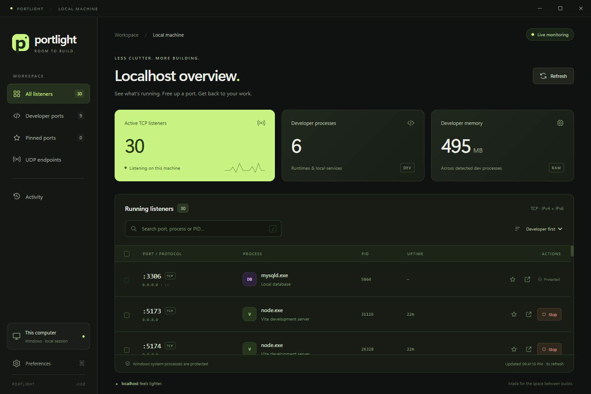

# Portlight

A Windows desktop app for seeing which localhost ports are running and stopping their owning processes. Built for Windows 11 with a dark, lime-accented interface.

A personal project by [Luqmannul Hakim](https://github.com/luqmannulhakimm).



## Open the app

Download **Portlight-1.0.0-portable.exe** from [GitHub Releases](https://github.com/luqmannulhakimm/portlight/releases/latest), then double-click it. No installation, Node.js or .NET runtime is needed.

For a local build, use `release/Portlight-1.0.0-portable.exe`. Alternatively, run `release/win-unpacked/Portlight.exe`; keep that entire folder together.

## Use it

- **All listeners** shows TCP servers listening on this machine, including loopback, wildcard and specific network interface binds. IPv4 and IPv6 listeners for the same process and port appear in one row.
- **Developer ports** filters recognized runtimes and local databases. Unrecognized applications are still listed under All listeners or UDP endpoints.
- **UDP endpoints** shows all bound UDP ports.
- Search by port, process, PID, path or command line. Press `/` to search and `Ctrl+R` or `F5` to refresh.
- Click a row for executable path, command line, memory, uptime and other ports owned by that process.
- Click **Stop**, review the affected ports, then confirm. Stopping a process releases all its TCP and UDP ports. It interrupts requests and unsaved in-memory state. Children are not terminated; a supervisor may restart a stopped app.
- Use checkboxes to stop multiple processes. A process that owns several selected ports is stopped only once.
- Star a port to pin it across restarts. Preferences persist locally; Activity records this app session only.
- Refresh happens every five seconds by default. Change the interval or pause it in Preferences.

Windows system processes, Portlight and its parent processes are protected. Processes whose identity or executable path cannot be read are also protected. To manage elevated applications or services, close Portlight, then right-click the executable and choose **Run as administrator**. System process protection still applies. This utility manages Windows-host processes; WSL/container-internal processes must be stopped inside their environment when Windows only exposes a forwarding service.

Browser links use HTTP. Database servers and other non-web services may not respond in a browser; change to HTTPS in the browser when required.

Everything runs on this computer. There is no telemetry or remote service. Preferences are stored in `%APPDATA%/portlight/preferences.json`.

## Development

```powershell
npm ci
npm start
```

```powershell
npm test
npm run test:ui
npm run build
```

To regenerate the application icon after editing `assets/icon.svg`, run `node scripts/create-icon.cjs` before building.

UI tests create their own IPv4 HTTP server, IPv6 HTTP server and UDP endpoint, then stop that fixture through the actual Electron UI. Existing user processes are not stopped. Test screenshots are saved under `artifacts/`. To test the packaged app, set `$env:PORTLIGHT_PACKAGED = '1'` before `npm run test:ui`.

PowerShell reads process metadata, `netstat -ano` enumerates listeners, and Windows process handles verify creation time before termination. Electron runs a sandboxed renderer with context isolation and a restricted IPC bridge.

The executable is locally built and unsigned. Source and dependency versions are recorded in this repository.

## License

MIT — see [LICENSE](LICENSE).
